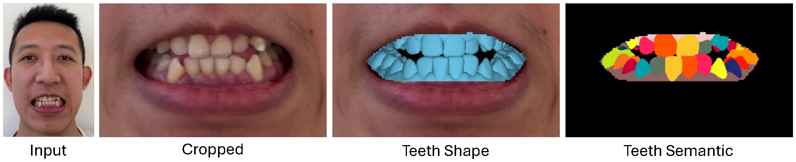

# MonoTeeth



This is the official PyTorch implementation of "3D Teeth Shape Reconstruction from a Single Face Image" (SIGGRAPH Asia 2026, Conference Track).

MonoTeeth reconstructs the personalized 3D teeth shape from a single RGB face image with visible teeth in a feed-forward manner, without test-time shape optimization.

## TODO

- [x] Release the training and inference code.
- [ ] Clean up and reorganize the current codebase.
- [ ] Release the training data and preprocessing code.

## Getting Started

Clone the repo:

```bash
git clone git@github.com:DeltaLiz/MonoTeeth.git
cd MonoTeeth
```

### Requirements

- Python 3.12
- CUDA 12.8
- PyTorch 2.10

Set up the environment:

```bash
conda create -n monoteeth python=3.12 -y
conda activate monoteeth
pip install -r requirements.txt
```

### Pretrained Weights

Place all weights under `pretrained/` as follows:

```text
pretrained/
├── sam3/
│   └── sam3.pt
├── dmm/
│   ├── upper/
│   │   ├── args.json
│   │   └── model.pth
│   └── lower/
│       ├── args.json
│       └── model.pth
└── monoteeth/
    ├── config.yaml
    └── pretrained.pt
```

Download the DMM and MonoTeeth weights from [Google Drive](https://drive.google.com/drive/folders/1kufEDiegrORdtq-hHMrEqBdk_gpYFebi?usp=sharing) and unzip them in the repository root.
For SAM 3, request access on the [SAM 3 Hugging Face page](https://huggingface.co/facebook/sam3), log in with `hf auth login`, and download the checkpoint:

```bash
hf download facebook/sam3 sam3.pt --local-dir pretrained/sam3
```

### Run Demo

From the repository root, run inference on an RGB mouth crop (308×182, W×H, mouth-centered):

```bash
python -m src.inference \
    --config pretrained/monoteeth/config.yaml \
    --ckpt pretrained/monoteeth/pretrained.pt \
    --image examples/00.png \
    --out-dir runs/infer/demo
```

It writes `upper.ply` and `lower.ply` (the gum and 14 teeth per jaw, in the canonical DMM space) to `--out-dir`.

## License

This repository includes code adapted from the following third-party projects; the adapted code remains under the original licenses:

- `src/third_party/sam3`: [SAM 3](https://github.com/facebookresearch/sam3), SAM License
- `src/third_party/dmm`: [DMM](https://github.com/cong-yi/DMM)

## Acknowledgements

This project is heavily based on the following works:

- [SAM 3](https://github.com/facebookresearch/sam3): image encoder.
- [DMM: An Implicit Parametric Morphable Dental Model](https://github.com/cong-yi/DMM): parametric teeth representation.

We thank the authors of these projects for releasing their code.